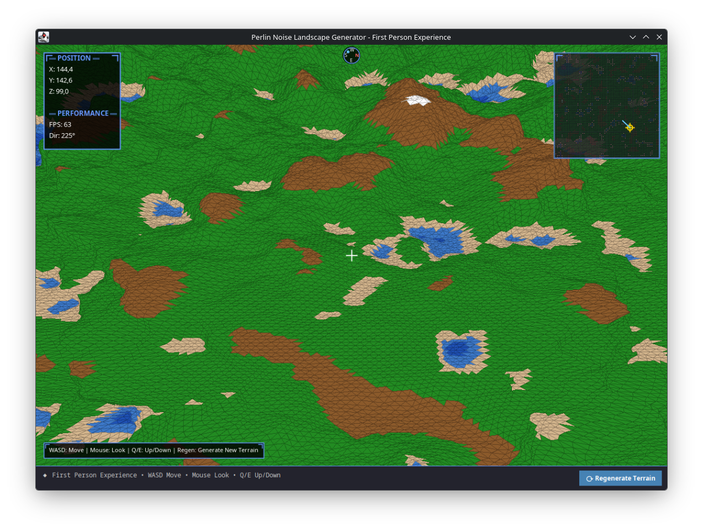
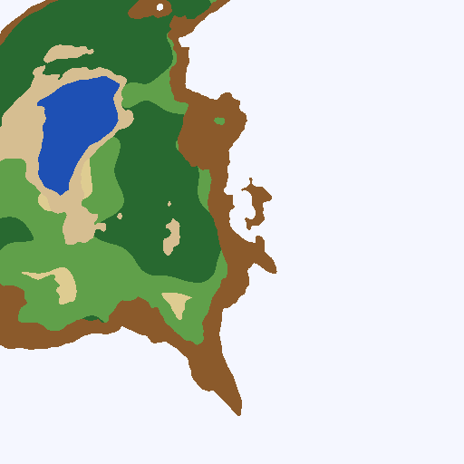

# Infinite Procedural Landscape

[](https://www.scala-lang.org)
[](flake.nix)
[](LICENSE)
[](https://github.com/sponsors/4ster-light)

An infinite 3D procedural landscape generated with Perlin and ridged noise,
featuring a **first-person immersive experience**, implemented in **Scala 3**
(Swing/AWT) with real-time software 3D visualization.

The same generator provides a Decline-powered command-line tool that
exports seeded PNG maps, ANSI-coloured ASCII, and layered SVG contours.

| Example Window                        | Example rendered PNG                                           |
|:-------------------------------------:|:--------------------------------------------------------------:|
|  |  |

## Features

### Language & Tooling

- **Scala 3.9**: renderer, map generator, CLI, camera and UI are all Scala
- **Scala code runner**: no Gradle/Maven build; configuration lives in
  `project.scala`. Recent Scala distributions ship the Scala CLI runner as
  `scala`, so no separate `scala-cli` package is required.
- **Nix flake**: dev shell, package, app and checks
- **Scalafmt + Scalafix**: shared formatting/config and an automated lint check
- **Hand-written graphics**: Swing/AWT and `javax.imageio` stay JDK-only
- **Decline CLI**: typed options, subcommands and library-quality help output
  (Cats is pulled in transitively by Decline)
- **Munit tests**: noise reference vectors, smoothness properties, biome tables,
  determinism, exporters and execution strategies

### First-Person Experience

- **WASD movement**: forward, backward and strafe relative to view direction
- **Mouse look**: yaw and pitch camera control
- **Vertical flight**: Q/E to ascend and descend
- **Collision detection**: keeps the camera above the terrain surface
- **Bilinear height interpolation**: smooth movement across grid cells

### Terrain Generation

- **Truly procedural world**: infinite terrain generated on demand; chunks are
  created as you explore and evicted from an LRU cache when far away
- **Layered noise**: domain-warped continentalness, erosion, rolling hills and
  ridged multifractal mountains combine for natural terrain
- **Biomes**: temperature and moisture fields drive beaches, deserts,
  grasslands, forests, savanna, rock and snow
- **Flat oceans**: water is rendered at sea level while the underlying height
  still controls deep vs. shallow coloring
- **Deterministic seeds**: every location is a pure function of its coordinates
  and seed, so revisiting an area regenerates it identically
- **Relief-aware spawn**: new worlds start on nearby rolling terrain rather
  than underwater or on a cliff
- **Procedural regeneration**: "Regenerate Terrain" creates a new infinite
  world with a different seed

### Advanced Rendering

- **Real-time software 3D**: perspective projection and painter's algorithm
- **Chunk streaming**: only chunks near the player are generated and cached
- **Culling**: near/far depth checks plus screen-space bounding-box rejection
- **Software rasterizer**: scanline triangle fills and Bresenham wireframes
- **One blit per frame**: the terrain is composed in a reusable pixel buffer
- **Color-coded terrain**:
  - Deep blue: deep water
  - Light blue: shallow water
  - Tan: sandy beaches
  - Pale yellow: deserts
  - Light green: grasslands
  - Dark green: forests
  - Olive: savanna
  - Brown: rocky mountains
  - White: snow-capped peaks

### Enhanced UI

- **HUD statistics**: player position, FPS and viewing direction
- **Local mini-map**: a scrolling 160×160-unit window around the player
- **Compass rose**: cardinal directions and heading indicator
- **Crosshair** and mouse-capture instructions
- **Modern styling**: dark theme, blue accents and decorative borders
- **Responsive controls**: visual feedback on the regenerate button

### Map Generation and Export

- **Opaque domain types**: `WorldCoordinate`, `GridCell`, `Altitude`,
  `Moisture` and `Latitude` keep units from being mixed at module boundaries
- **Composable noise values**: `Noise[A]` layers with `fBm`, `ridged`, `warp`,
  `mix`/`blend` and `map`
- **Two-channel terrain**: altitude plus moisture drive an exhaustive
  `enum Biome` classification
- **PNG export**: biome-coloured maps through `javax.imageio`
- **ANSI ASCII export**: a height ramp with 24-bit colour, or plain text
- **SVG export**: layered marching-squares terrain contours
- **Seeded and deterministic**: every map is a pure function of its seed and
  parameters

### Execution Strategies and Benchmarks

- **Sequential**: straightforward single-threaded generation
- **Parallel**: JVM parallel-stream fan-out
- **Chunked**: `Future` fan-out sized to `Runtime.getRuntime.availableProcessors`
- **Benchmark command**: JVM warm-up, repeated runs, min/median timings and
  speedup ratios against the sequential baseline

## Project Structure

```plaintext
.
├── project.scala              - Scala code-runner directives (Scala 3.9, test dep)
├── .scalafmt.conf             - shared Scalafmt configuration
├── .scalafix.conf             - Scalafix rules (DisableSyntax, imports, for-comprehensions)
├── flake.nix                  - Nix dev shell, package, app and checks
├── flake.lock
├── scripts/
│   └── check.sh               - compile + format + Scalafix + test check
├── docs/
│   └── example-map.png        - example CLI-generated map
├── src/main/scala/perlin/
│   ├── app/
│   │   └── Main.scala         - GUI entry point and CLI dispatch
│   ├── cli/
│   │   ├── CliMain.scala      - generate/render/benchmark/gui subcommands
│   │   └── Benchmark.scala    - warm-up, repetitions and speedup table
│   ├── core/
│   │   └── Units.scala        - opaque WorldCoordinate/GridCell/Altitude units
│   ├── noise/
│   │   ├── PerlinNoise.scala  - seeded Perlin, octave and ridged noise
│   │   └── Noise.scala        - composable Noise[A] and combinators
│   ├── world/
│   │   ├── Biome.scala        - exhaustive Biome enum and classifier
│   │   ├── WorldMap.scala     - parameters, samples, maps and chunks
│   │   └── WorldGenerator.scala - pure seeded altitude/moisture pipeline
│   ├── execution/
│   │   └── ExecutionStrategy.scala - sequential, parallel and chunked strategies
│   ├── output/
│   │   ├── Palette.scala      - shared biome colours and ASCII ramp
│   │   ├── PngExporter.scala  - javax.imageio PNG writer
│   │   ├── AsciiExporter.scala - ANSI/plain ASCII renderer
│   │   └── SvgExporter.scala  - marching-squares SVG contours
│   ├── terrain/
│   │   └── Terrain.scala      - infinite chunked GUI terrain and legacy palette
│   ├── camera/
│   │   ├── Camera.scala       - first-person camera with WASD + mouse look
│   │   └── CollisionDetector.scala - terrain collision and camera constraints
│   ├── render/
│   │   ├── Renderer3D.scala   - projection, culling, painter ordering and frame loop
│   │   ├── SoftwareRasterizer.scala - pixel buffer, scanline fills and wireframe lines
│   │   └── ViewFrustum.scala  - camera frustum helpers
│   └── ui/
│       └── HeadsUpDisplay.scala - HUD rendering with stats and local mini-map
└── src/test/scala/perlin/
    ├── noise/                 - reference vectors, smoothness and composition
    ├── world/                 - biome table and deterministic generation
    ├── execution/             - strategy equivalence
    └── output/                - PNG/ASCII/SVG smoke tests
```

Sources use the standard code-runner layout (`src/main/scala`, `src/test/scala`).
The root package is `perlin`. The interactive viewer lives in `perlin.app`,
`perlin.terrain`, `perlin.camera`, `perlin.render` and `perlin.ui`; the new map
pipeline lives in `perlin.core`, `perlin.noise`, `perlin.world`,
`perlin.execution` and `perlin.output`.

## Running

### Run directly from GitHub with Nix

If you only want to try the latest revision without cloning:

```bash
nix run github:4ster-light/perlin
```

A specific branch, tag or commit can be selected with:

```bash
nix run github:4ster-light/perlin/<ref>
```

Build without launching it:

```bash
nix build github:4ster-light/perlin
```

### Run from a local clone with Nix

```bash
git clone https://github.com/4ster-light/perlin.git
cd perlin
nix run .
```

### Run with an existing Scala toolchain

If you don't have Nix, as long as Scala runner (Scala 3.5+, prefer 3.9.0 for this project) or `scala-cli` is available:

```bash
scala run . # or scala-cli run .
```

Scala version, compiler options and the main class are declared in
`project.scala`, so no separate build script is needed.

### Build a standalone launcher

```bash
nix build
./result/bin/perlin-landscape
```

The flake uses `scala --power package --assembly` (the Scala CLI runner built
into the `scala` distribution) to produce a self-contained JAR and wraps it with
the Nix-provided JDK. The same command works with
`nix build github:4ster-light/perlin`.

## Command-line Map Generator

`scala run .` with no arguments launches the interactive viewer. With arguments
it dispatches to the CLI, so the same entry point supports both workflows:

```bash
# Show every subcommand and option
scala run . -- --help

# Launch the viewer explicitly
scala run . -- gui

# Generate a map and print a biome histogram
scala run . -- generate --seed 42 --width 128 --height 96

# Export PNG (the default format)
scala run . -- render --seed 42 --width 1024 --height 1024 --output map.png

# Export plain ASCII
scala run . -- render --seed 42 --width 120 --height 60 --format ascii --no-color

# Export layered SVG contours
scala run . -- render --seed 42 --format svg --levels 12 --output contours.svg

# Benchmark all three execution strategies
scala run . -- benchmark --width 1024 --height 1024 --octaves 6 --reps 5
```

The packaged launcher accepts the same arguments:

```bash
nix run . -- render --seed 42 --width 1024 --height 1024 --output map.png
./result/bin/perlin-landscape benchmark --width 1024 --height 1024
```

The CLI is built with [Decline](https://monovore.com/decline), so subcommands,
typed option parsing, validation errors and `--help` output come from the
library rather than a hand-written parser. Cats is pulled in transitively by
Decline. The renderer, terrain code and exporters remain hand-written on JDK
APIs.

## Map Generation Pipeline

The map pipeline is separate from the legacy interactive terrain and is built
from pure values:

- **Opaque units** in `perlin.core`: `WorldCoordinate`, `GridCell`, `Altitude`,
  `Moisture` and `Latitude`. `Altitude` and `Moisture` clamp to `[0, 1]` at the
  boundary.
- **`Noise[A]`** in `perlin.noise`: a function from a world coordinate to a
  value, with `map`, `fBm`, `ridged`, `warp`, `mix` and `blend` combinators.
- **`WorldGenerator`** in `perlin.world`: combines continentalness, hills,
  ridged mountains and domain warping into an altitude field, then samples a
  separate moisture field. `WorldMap` rows are `LazyList`s, and
  `generateChunks` realises bounded chunks on demand.
- **`enum Biome`**: `Ocean`, `Beach`, `Grassland`, `Forest`, `Desert`, `Tundra`,
  `Mountain` and `SnowPeak`, classified by exhaustive pattern matching over
  altitude, moisture and latitude.
- **Determinism**: the same `TerrainParameters` always produces identical
  samples. There is no unseeded randomness in the map pipeline.

A layer can be composed directly:

```scala
import perlin.noise.Noise
import perlin.noise.Noise.*

val perlin = Noise.perlin(42L)
val terrain = Noise
  .fBm(perlin, 5)
  .blend(Noise.ridged(perlin, 4))
  .map(value => value.pow(1.3))
```

## Benchmark Results

Measured with `perlin benchmark --width 1024 --height 1024 --octaves 6 --reps 3`
on a 14-processor machine, after one full warm-up run per strategy:

| Strategy   | Min (ms) | Median (ms) | Min speedup | Median speedup |
|------------|---------:|------------:|------------:|---------------:|
| sequential |    793.2 |       825.4 |       1.00x |          1.00x |
| parallel   |    212.9 |       218.7 |       3.73x |          3.77x |
| chunked    |    202.7 |       207.9 |       3.91x |          3.97x |

The checksum was identical for all three strategies (`971378.4`), confirming
that parallelism changes only execution, not the generated world.

## Installing with Nix

Install the application into your Nix profile:

```bash
nix profile add github:4ster-light/perlin
perlin-landscape
```

Remove it later with:

```bash
nix profile remove perlin-landscape
```

For a NixOS or Home Manager configuration, add the flake as an input:

```nix
# flake.nix
inputs.perlin.url = "github:4ster-light/perlin";
```

Then expose the package:

```nix
# configuration.nix / home.nix
{ pkgs, inputs, ... }:
{
  environment.systemPackages = [
    inputs.perlin.packages.${pkgs.stdenv.hostPlatform.system}.default
  ];

  # Home Manager alternative:
  # home.packages = [
  #   inputs.perlin.packages.${pkgs.stdenv.hostPlatform.system}.default
  # ];
}
```

From a local checkout, `nix profile add .` installs the same package.

## Controls

| Input              | Action                                     |
|--------------------|--------------------------------------------|
| **W**              | Move forward                               |
| **S**              | Move backward                              |
| **A**              | Strafe left                                |
| **D**              | Strafe right                               |
| **Q**              | Ascend                                     |
| **E**              | Descend                                    |
| **Mouse Movement** | Look around / rotate camera                |
| **Esc**            | Release captured mouse                     |
| **Button Click**   | Generate a new world with a different seed |

Click the viewport to capture the mouse. The crosshair marks the view center.

## Using the HUD

### Top-left: Position & Performance

- Current `X`, `Y`, `Z` world coordinates
- Painted-frame FPS counter
- Current bearing in degrees

### Top-right: Local Mini-map

- Local top-down view colored by height and biome
- Yellow crosshair: your position (always at the map center)
- Blue line: your viewing direction
- Gray grid: orientation reference
- The map scrolls and rebuilds as you explore

### Top-center: Compass

- Cardinal directions `N`, `E`, `S`, `W`
- Dot showing your current heading

### Bottom-left: Control Hints

- Quick reference for movement, mouse look and regeneration

## Exploration Tips

1. **Start high**: press Q after spawning for a better overview
2. **Follow water**: coastlines often lead to varied terrain
3. **Find mountains**: look for brown and white regions on the mini-map
4. **Use the compass** to avoid getting turned around
5. **Watch FPS** and reduce render distance if performance drops
6. **Try different seeds**: every regeneration creates a new infinite world

## Terrain and Biomes

The world is infinite and chunked. Surface colors combine elevation with
temperature and moisture:

- **Deep water** (`#1E50B4`) and **shallow water** (`#3C78C8`)
- **Beaches** (`#D6BE91`)
- **Deserts** (`#DECC91`)
- **Grasslands** (`#60A04A`)
- **Forests** (`#286930`)
- **Savanna** (`#A0A552`)
- **Rock** (`#8B5A2B`)
- **Snow** (`#F5F7FF`)

Oceans are flat at sea level, while the underlying noise still decides whether
water is deep or shallow. Terrain height comes from four noise layers:

- **Continentalness**: large ocean basins and land masses
- **Erosion**: broad flat areas vs. rough terrain
- **Hills**: local rolling relief
- **Ridged noise**: sharp mountain crests

The CLI map pipeline uses the exhaustive `Biome` enum instead of palette
indices: `Ocean`, `Beach`, `Grassland`, `Forest`, `Desert`, `Tundra`,
`Mountain` and `SnowPeak`. Classification is a pure function of altitude,
moisture and latitude, and the compiler rejects non-exhaustive matches.

## Technical Details

### Scala 3 Architecture

- Opaque domain types for coordinates, grid cells, altitude, moisture and
  latitude
- `Noise[A]` as a pure, composable value with `fBm`, `ridged`, `warp` and
  `blend` combinators
- Scala 3 `enum`s for input keys and biomes
- `LazyList` rows and chunked generation so the whole map never has to exist in
  memory
- Immutable `case class` value types for HUD snapshots and camera vectors
- Java Swing/AWT interop for windows, timers and graphics
- Hot rendering loops use primitive `Array`s and `while` loops

### Noise

- Permutation table with Fisher-Yates shuffle for pseudo-randomness
- Explicit seeds only; no unseeded `scala.util.Random` in the map pipeline
- Gradient interpolation with smooth fade curves
- Octave layering for fractal detail
- Ridged multifractal noise for mountain ridges
- Domain warping to break up grid-aligned patterns
- Masked `mix`/`blend` for combining layers

### Execution Strategies

- `ExecutionStrategy.Sequential`: plain `map`
- `ExecutionStrategy.Parallel`: `IntStream.parallel`
- `ExecutionStrategy.Chunked`: `Future` fan-out with a fixed pool sized to the
  available processors
- All strategies share the same interface and are checked for output equality

### Camera and Collision

- Full 6-DOF movement (forward/back, left/right, up/down)
- Euler angle rotation (pitch and yaw) from mouse input
- Camera height offset from the terrain surface
- Infinite traversal with only a numeric world-limit safety net
- Timer-driven update/paint on the Swing EDT

### Rendering and Performance

- **Chunk streaming**: only chunks visible around the player are generated and
  cached; the rest of the infinite world does not exist in memory
- **Render distance**: ~120 world units by default
- **Culling**: near/far checks plus screen-space bounding-box rejection
- **Software rasterizer**: scanline triangle fills and Bresenham wireframes
  avoid per-triangle Java2D overhead
- **Reusable buffers**: vertex, triangle and frame buffers are retained between
  frames, making the hot path allocation-free
- **Primitive depth sort**: packed `long` keys replace per-triangle objects and
  comparator sorting
- **Cached HUD artwork**: the local mini-map is rebuilt only when the player
  moves; fonts, metrics and palettes are cached
- **Uniform wireframe mesh**: every triangle carries its border, giving the demo
  its signature polygon-y look

## Customization

### Seed

Choose a seed in `src/main/scala/perlin/app/Main.scala`:

```scala
val seed = System.currentTimeMillis()
val terrain = new Terrain(seed)
```

### World Generation

The interesting worldgen lives in `src/main/scala/perlin/terrain/Terrain.scala`:

```scala
private val CHUNK_SIZE = 16        // Height samples per chunk edge
private val SEA_LEVEL = 16.0       // Flat ocean height
private val MAX_CACHED_CHUNKS = 4096
```

`generateHeight(...)` combines continentalness, erosion, hills and ridged
mountains. `surfaceColorIndex(...)` maps elevation, temperature and moisture to
biomes. Try changing the `smoothstep` thresholds or the multipliers on `hills`
and `ridge` to make the world flatter, more mountainous, or more island-like.

### Camera

Edit `src/main/scala/perlin/camera/Camera.scala`:

```scala
private val MOVEMENT_SPEED = 1.2      // Units per frame
private val VERTICAL_SPEED = 0.8      // Up/down speed
private val MOUSE_SENSITIVITY = 0.15  // Degrees per pixel
```

### Rendering

Edit `src/main/scala/perlin/render/Renderer3D.scala`:

```scala
private val FOV = 70.0             // Field of view in degrees
val RENDER_DISTANCE = 120          // How far to render (world units)
```

## Testing

The test suite uses Munit and lives in `src/test/scala`. It covers:

- hardcoded permutation-table and noise reference vectors
- gradient smoothness and range properties
- biome classification table cases
- seeded determinism and chunk/map equivalence
- `Noise` composition, blending and warping
- PNG, ASCII and SVG exporter smoke tests
- equality of sequential, parallel and chunked generation

```bash
scala test .
```

## Formatting, Linting and Checks

Formatting is configured in `.scalafmt.conf` and linting in `.scalafix.conf`.
The Scalafix rules include `DisableSyntax`, `LeakingImplicitClassVal`,
`NoValInForComprehension` and `OrganizeImports`. `project.scala` enables
SemanticDB, unused-import warnings, `-Werror` and Scalafix metadata.

`scala fmt` is a wrapper around Scalafmt, so it is fine for everyday formatting.
The flake still pins the standalone `scalafmt` binary so `nix flake check` can
format-check without downloading the formatter inside the sandbox. Scalafix is a
separate tool, not part of the Scala runner; it needs SemanticDB from a prior
compile and an explicit `--scala-version`, otherwise it parses Scala 3 sources as
Scala 2 and fails.

```bash
# format sources (either works)
scala fmt .
scalafmt .

# compile first so Scalafix can find SemanticDB
scala compile .

# apply fixes (including import organisation)
scalafix --auto-classpath --scalac-options -Wunused:imports \
  --scala-version 3.9.0 src/main/scala

# or only verify
scalafix --auto-classpath --scalac-options -Wunused:imports \
  --scala-version 3.9.0 --check src/main/scala
```

The helper script runs the whole local check:

```bash
scala run scripts/check.scala
# or, inside the Nix shell:
nix develop -c scala run scripts/check.scala
```

Run the full Nix check suite:

```bash
nix flake check
```

This compiles the project, runs `scalafmt --test` and runs `scalafix --check`.
Tests are run separately with `scala test .` because they use a test-scoped
Munit dependency.

## Performance Tuning

### For Slow Systems

- Reduce `RENDER_DISTANCE` to 60–80
- Reduce `CHUNK_SIZE` if you prefer smaller streaming hitches
- Lower `MAX_CACHED_CHUNKS` to cap memory use more aggressively
- Reduce `PRELOAD_RADIUS` in `Main.scala`

### For Fast Systems

- Increase `RENDER_DISTANCE` to 160–200
- Increase `MAX_CACHED_CHUNKS` if you explore large areas
- Raise `PRELOAD_RADIUS` in `Main.scala` for a larger initial buffer

## Troubleshooting

### Window won't open

```bash
# Enter the Nix dev shell and launch from there
nix develop -c scala run .

# Or run the packaged launcher
nix run github:4ster-light/perlin
nix build
./result/bin/perlin-landscape
```

### Compilation fails

Make sure you have Scala 3.9+ and JDK 21+. The easiest path is:

```bash
nix develop
scala compile .
```

On a headless machine, run the GUI under Xvfb:

```bash
nix shell nixpkgs#scala_3 nixpkgs#xvfb-run -c xvfb-run -a scala run .
```

### Performance is slow

- Reduce `RENDER_DISTANCE`
- Reduce `PRELOAD_RADIUS` in `Main.scala`
- Lower movement/mouse sensitivity if input feels laggy

### Can't move

- Make sure the window is focused and you are not hovering over a button
- Check that WASD is not captured by another application
- Click the viewport to capture the mouse

### Camera controls feel wrong

- Adjust `MOUSE_SENSITIVITY`
- Adjust `MOVEMENT_SPEED` if navigation feels too slow or fast

### Terrain looks flat

- Increase the `ridge` multiplier in `generateHeight(...)`
- Lower the mountain `smoothstep` thresholds so mountains appear more often
- Increase the `hills` multiplier or amplitude for rougher ground

### No terrain visible

- Ensure the window is large enough
- Try moving with WASD or adjusting the camera with the mouse
- Check that you have not flown too far above the landscape

## Requirements

- [Nix](https://nixos.org/) with flakes enabled (recommended), or
- Scala 3.9+ with a JDK 21+ on `PATH` (the Nix shell uses JDK 21)
- Runtime dependencies are limited to Decline/Cats for the CLI; Munit is
  test-only, and the renderer/exporters use JDK APIs

## License

This project is licensed under the MIT License - see the [LICENSE](LICENSE) file
for details.
