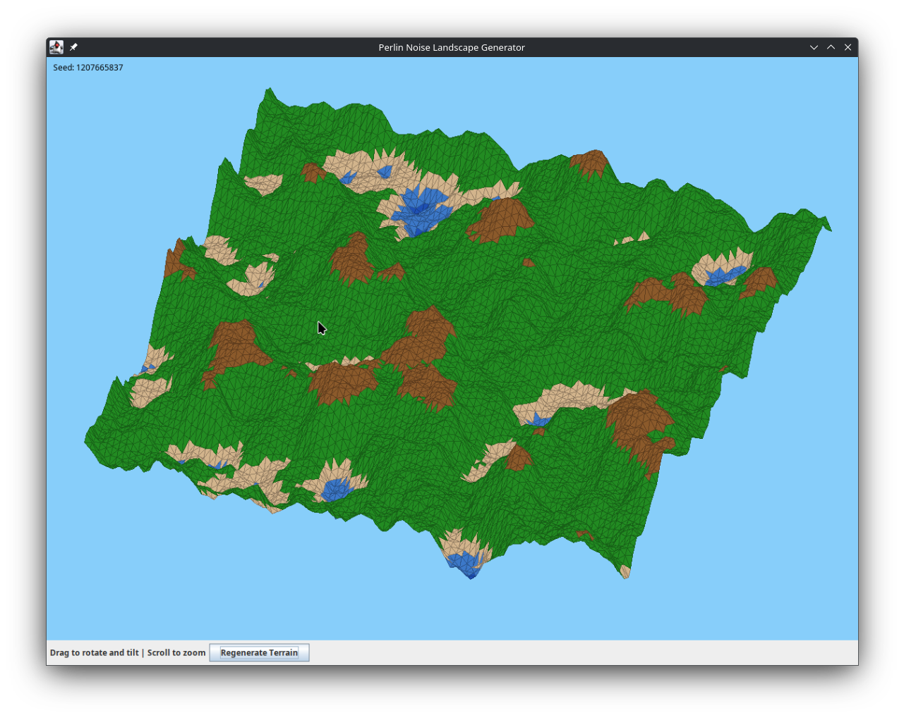

# Infinite Procedural Landscape

An infinite 3D procedural landscape generated with Perlin and ridged noise,
featuring a **first-person immersive experience**, implemented in **Scala 3**
(Swing/AWT) with real-time software 3D visualization.



## Features

### Language & Tooling

- **Scala 3**: renderer, world generator, camera and UI are all Scala
- **scala-cli**: no Gradle/Maven build; configuration lives in `project.scala`
- **Nix flake**: dev shell, package, app and checks
- **Scalafmt + Scalafix**: shared formatting/config and an automated lint check
- **JDK Swing/AWT only** at runtime - no third-party runtime libraries

### First-Person Experience

- **WASD movement**: forward, backward and strafe relative to view direction
- **Mouse look**: yaw and pitch camera control
- **Vertical flight**: Q/E to ascend and descend
- **Collision detection**: keeps the camera above the terrain surface
- **Bilinear height interpolation**: smooth movement across grid cells

### Terrain Generation

- **Truly procedural world**: infinite terrain generated on demand; chunks are
  created as you explore and evicted from an LRU cache when far away
- **Layered noise**: domain-warped continentalness, erosion, rolling hills and
  ridged multifractal mountains combine for natural terrain
- **Biomes**: temperature and moisture fields drive beaches, deserts,
  grasslands, forests, savanna, rock and snow
- **Flat oceans**: water is rendered at sea level while the underlying height
  still controls deep vs. shallow coloring
- **Deterministic seeds**: every location is a pure function of its coordinates
  and seed, so revisiting an area regenerates it identically
- **Relief-aware spawn**: new worlds start on nearby rolling terrain rather
  than underwater or on a cliff
- **Procedural regeneration**: "Regenerate Terrain" creates a new infinite
  world with a different seed

### Advanced Rendering

- **Real-time software 3D**: perspective projection and painter's algorithm
- **Chunk streaming**: only chunks near the player are generated and cached
- **Culling**: near/far depth checks plus screen-space bounding-box rejection
- **Software rasterizer**: scanline triangle fills and Bresenham wireframes
- **One blit per frame**: the terrain is composed in a reusable pixel buffer
- **Color-coded terrain**:
  - Deep blue: deep water
  - Light blue: shallow water
  - Tan: sandy beaches
  - Pale yellow: deserts
  - Light green: grasslands
  - Dark green: forests
  - Olive: savanna
  - Brown: rocky mountains
  - White: snow-capped peaks

### Enhanced UI

- **HUD statistics**: player position, FPS and viewing direction
- **Local mini-map**: a scrolling 160×160-unit window around the player
- **Compass rose**: cardinal directions and heading indicator
- **Crosshair** and mouse-capture instructions
- **Modern styling**: dark theme, blue accents and decorative borders
- **Responsive controls**: visual feedback on the regenerate button

## Project Structure

```plaintext
.
├── project.scala              - scala-cli directives (Scala 3.9, options, main class)
├── .scalafmt.conf             - shared Scalafmt configuration
├── .scalafix.conf             - Scalafix rules (OrganizeImports)
├── flake.nix                  - Nix dev shell, package, app and checks
├── flake.lock
└── src/dev/aster/
    ├── app/
    │   └── Main.scala         - Application entry point and GUI setup
    ├── noise/
    │   └── PerlinNoise.scala  - Perlin and ridged noise implementation
    ├── terrain/
    │   └── Terrain.scala      - Infinite chunked terrain generation and biomes
    ├── camera/
    │   ├── Camera.scala       - First-person camera with WASD + mouse look
    │   └── CollisionDetector.scala - Terrain collision and camera constraints
    ├── render/
    │   ├── Renderer3D.scala   - Projection, software rasterizer and frame loop
    │   └── ViewFrustum.scala  - Camera frustum helpers
    └── ui/
        └── HeadsUpDisplay.scala - HUD rendering with stats and local mini-map
```

Each concern lives in its own package (`app`, `noise`, `terrain`, `camera`,
`render`, `ui`). scala-cli discovers the sources and compiles them together.

## Running

### Run directly from GitHub with Nix

If you only want to try the latest revision without cloning:

```bash
nix run github:4ster-light/perlin
```

A specific branch, tag or commit can be selected with:

```bash
nix run github:4ster-light/perlin/<ref>
```

Build without launching it:

```bash
nix build github:4ster-light/perlin
./result/bin/perlin-landscape
```

### Run from a local clone with Nix

```bash
git clone https://github.com/4ster-light/perlin.git
cd perlin
nix develop
scala run .
```

Or as a one-liner:

```bash
nix develop -c scala run .
```

If you already have Scala tooling and only want the project's compiler version:

```bash
nix shell nixpkgs#scala_3 -c scala run .
```

### Run with an existing Scala toolchain

Requires Scala 3.9+ and JDK 21+ (the Nix development shell uses JDK 25):

```bash
scala run .
```

Scala version, compiler options and the main class are declared in
`project.scala`, so no separate build script is needed.

### Build a standalone launcher

```bash
nix build
./result/bin/perlin-landscape
```

The flake uses `scala-cli package --assembly` to produce a self-contained JAR
and wraps it with the Nix-provided JDK. The same command works with
`nix build github:4ster-light/perlin`.

## Installing with Nix

Install the application into your Nix profile:

```bash
nix profile install github:4ster-light/perlin
perlin-landscape
```

Remove it later with:

```bash
nix profile remove perlin-landscape
```

For a NixOS or Home Manager configuration, add the flake as an input:

```nix
# flake.nix
inputs.perlin.url = "github:4ster-light/perlin";
```

Then expose the package:

```nix
# configuration.nix / home.nix
{ pkgs, inputs, ... }:
{
  environment.systemPackages = [
    inputs.perlin.packages.${pkgs.stdenv.hostPlatform.system}.default
  ];

  # Home Manager alternative:
  # home.packages = [
  #   inputs.perlin.packages.${pkgs.stdenv.hostPlatform.system}.default
  # ];
}
```

From a local checkout, `nix profile install .` installs the same package.

## Controls

| Input              | Action                                   |
| ------------------ | ---------------------------------------- |
| **W**              | Move forward                             |
| **S**              | Move backward                            |
| **A**              | Strafe left                              |
| **D**              | Strafe right                             |
| **Q**              | Ascend                                   |
| **E**              | Descend                                  |
| **Mouse Movement** | Look around / rotate camera              |
| **Esc**            | Release captured mouse                   |
| **Button Click**   | Generate a new world with a different seed |

Click the viewport to capture the mouse. The crosshair marks the view center.

## Using the HUD

### Top-left: Position & Performance

- Current `X`, `Y`, `Z` world coordinates
- Painted-frame FPS counter
- Current bearing in degrees

### Top-right: Local Mini-map

- Local top-down view colored by height and biome
- Yellow crosshair: your position (always at the map center)
- Blue line: your viewing direction
- Gray grid: orientation reference
- The map scrolls and rebuilds as you explore

### Top-center: Compass

- Cardinal directions `N`, `E`, `S`, `W`
- Dot showing your current heading

### Bottom-left: Control Hints

- Quick reference for movement, mouse look and regeneration

## Exploration Tips

1. **Start high**: press Q after spawning for a better overview
2. **Follow water**: coastlines often lead to varied terrain
3. **Find mountains**: look for brown and white regions on the mini-map
4. **Use the compass** to avoid getting turned around
5. **Watch FPS** and reduce render distance if performance drops
6. **Try different seeds**: every regeneration creates a new infinite world

## Terrain and Biomes

The world is infinite and chunked. Surface colors combine elevation with
temperature and moisture:

- **Deep water** (`#1E50B4`) and **shallow water** (`#3C78C8`)
- **Beaches** (`#D6BE91`)
- **Deserts** (`#DECC91`)
- **Grasslands** (`#60A04A`)
- **Forests** (`#286930`)
- **Savanna** (`#A0A552`)
- **Rock** (`#8B5A2B`)
- **Snow** (`#F5F7FF`)

Oceans are flat at sea level, while the underlying noise still decides whether
water is deep or shallow. Terrain height comes from four noise layers:

- **Continentalness**: large ocean basins and land masses
- **Erosion**: broad flat areas vs. rough terrain
- **Hills**: local rolling relief
- **Ridged noise**: sharp mountain crests

## Technical Details

### Scala 3 Architecture

- Immutable `case class` value types for HUD snapshots and camera vectors
- Scala 3 `enum` for input keys
- Java Swing/AWT interop for windows, timers and graphics
- Hot rendering loops use primitive `Array`s and `while` loops

### Noise

- Permutation table with Fisher-Yates shuffle for pseudo-randomness
- Gradient interpolation with smooth fade curves
- Octave layering for fractal detail
- Ridged multifractal noise for mountain ridges
- Domain warping to break up grid-aligned patterns

### Camera and Collision

- Full 6-DOF movement (forward/back, left/right, up/down)
- Euler angle rotation (pitch and yaw) from mouse input
- Camera height offset from the terrain surface
- Infinite traversal with only a numeric world-limit safety net
- Timer-driven update/paint on the Swing EDT

### Rendering and Performance

- **Chunk streaming**: only chunks visible around the player are generated and
  cached; the rest of the infinite world does not exist in memory
- **Render distance**: ~120 world units by default
- **Culling**: near/far checks plus screen-space bounding-box rejection
- **Software rasterizer**: scanline triangle fills and Bresenham wireframes
  avoid per-triangle Java2D overhead
- **Reusable buffers**: vertex, triangle and frame buffers are retained between
  frames, making the hot path allocation-free
- **Primitive depth sort**: packed `long` keys replace per-triangle objects and
  comparator sorting
- **Cached HUD artwork**: the local mini-map is rebuilt only when the player
  moves; fonts, metrics and palettes are cached
- **Uniform wireframe mesh**: every triangle carries its border, giving the demo
  its signature polygon-y look

## Customization

### Seed

Choose a seed in `src/dev/aster/app/Main.scala`:

```scala
val seed = System.currentTimeMillis()
val terrain = new Terrain(seed)
```

### World Generation

The interesting worldgen lives in `src/dev/aster/terrain/Terrain.scala`:

```scala
private val CHUNK_SIZE = 16        // Height samples per chunk edge
private val SEA_LEVEL = 16.0       // Flat ocean height
private val MAX_CACHED_CHUNKS = 4096
```

`generateHeight(...)` combines continentalness, erosion, hills and ridged
mountains. `surfaceColorIndex(...)` maps elevation, temperature and moisture to
biomes. Try changing the `smoothstep` thresholds or the multipliers on `hills`
and `ridge` to make the world flatter, more mountainous, or more island-like.

### Camera

Edit `src/dev/aster/camera/Camera.scala`:

```scala
private val MOVEMENT_SPEED = 1.2      // Units per frame
private val VERTICAL_SPEED = 0.8      // Up/down speed
private val MOUSE_SENSITIVITY = 0.15  // Degrees per pixel
```

### Rendering

Edit `src/dev/aster/render/Renderer3D.scala`:

```scala
private val FOV = 70.0             // Field of view in degrees
val RENDER_DISTANCE = 120          // How far to render (world units)
```

## Formatting, Linting and Checks

Formatting is configured in `.scalafmt.conf` and linting in `.scalafix.conf`.
`project.scala` enables SemanticDB and unused-import warnings for Scalafix.

```bash
# format sources
scalafmt .

# compile first so Scalafix can find SemanticDB
scala compile .

# apply OrganizeImports
scalafix --auto-classpath --scalac-options -Wunused:imports src

# or only verify
scalafix --auto-classpath --scalac-options -Wunused:imports --check src
```

Run the full Nix check suite:

```bash
nix flake check
```

This compiles the project, runs `scalafmt --test` and runs `scalafix --check`.

## Performance Tuning

### For Slow Systems

- Reduce `RENDER_DISTANCE` to 60–80
- Reduce `CHUNK_SIZE` if you prefer smaller streaming hitches
- Lower `MAX_CACHED_CHUNKS` to cap memory use more aggressively
- Reduce `PRELOAD_RADIUS` in `Main.scala`

### For Fast Systems

- Increase `RENDER_DISTANCE` to 160–200
- Increase `MAX_CACHED_CHUNKS` if you explore large areas
- Raise `PRELOAD_RADIUS` in `Main.scala` for a larger initial buffer

## Troubleshooting

### Window won't open

```bash
# Enter the Nix dev shell and launch from there
nix develop -c scala run .

# Or run the packaged launcher
nix run github:4ster-light/perlin
nix build
./result/bin/perlin-landscape
```

### Compilation fails

Make sure you have Scala 3.9+ and JDK 21+. The easiest path is:

```bash
nix develop
scala compile .
```

On a headless machine, run the GUI under Xvfb:

```bash
nix shell nixpkgs#scala_3 nixpkgs#xvfb-run -c xvfb-run -a scala run .
```

### Performance is slow

- Reduce `RENDER_DISTANCE`
- Reduce `PRELOAD_RADIUS` in `Main.scala`
- Lower movement/mouse sensitivity if input feels laggy

### Can't move

- Make sure the window is focused and you are not hovering over a button
- Check that WASD is not captured by another application
- Click the viewport to capture the mouse

### Camera controls feel wrong

- Adjust `MOUSE_SENSITIVITY`
- Adjust `MOVEMENT_SPEED` if navigation feels too slow or fast

### Terrain looks flat

- Increase the `ridge` multiplier in `generateHeight(...)`
- Lower the mountain `smoothstep` thresholds so mountains appear more often
- Increase the `hills` multiplier or amplitude for rougher ground

### No terrain visible

- Ensure the window is large enough
- Try moving with WASD or adjusting the camera with the mouse
- Check that you have not flown too far above the landscape

## Requirements

- [Nix](https://nixos.org/) with flakes enabled (recommended), or
- Scala 3.9+ with a JDK 21+ on `PATH` (the Nix shell uses JDK 25)
- No third-party runtime libraries

## License

This project is licensed under the MIT License - see the [LICENSE](LICENSE) file
for details.
